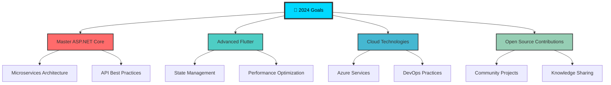

<div align="center">

# 👋 Hello, I'm **Lê Bảo Thiện**


[](https://github.com/BiTi1903)
[](https://github.com/BiTi1903?tab=followers)
[](https://github.com/BiTi1903?tab=repositories)

</div>

---

<div align="center">

## 🎯 **About Me**

<table>
<tr>
<td>

**👨‍💻 Full-Stack Developer**  
**📍 Vietnam 🇻🇳**  
**💼 3+ years experience**  

**🛠️ Tech Stack:**
- **Backend:** ASP.NET Core • C# • SQL Server
- **Mobile:** Flutter • Dart • Firebase  
- **Frontend:** HTML5 • CSS3 • JavaScript
- **Tools:** Git • VS Code • Postman

**💡 What drives me:**
- Clean Code 💻 • Problem Solving 🧩 • Innovation 🚀 • Learning 📚

**🎯 Current Focus:**
- Advanced Flutter Development • Microservices Architecture • Cloud Technologies • Open Source Contributions

*✨ "Building the future, one commit at a time!"*

</td>
<td>


</td>
</tr>
</table>

</div>

---

<div align="center">

## 🛠️ **Tech Stack & Skills**


### **💻 Programming Languages**
<p>
  
</p>

### **🚀 Frameworks & Technologies**
<p>
  
</p>

### **🗄️ Databases & Cloud**
<p>
  
</p>

### **⚙️ Development Tools**
<p>
  
</p>

</div>

---

<div align="center">

## 📊 **GitHub Statistics**


<table>
<tr>
<td>

</td>
<td>

</td>
</tr>
</table>


</div>

---

<div align="center">

## 🏆 **Achievements & Trophies**


</div>

---

<div align="center">

## 🎯 **Current Focus & Goals**




</div>

---

<div align="center">

## 🚀 **Featured Projects**


<table>
<tr>
<td width="50%">

### 🌟 **E-Commerce Platform**


**Tech Stack:** ASP.NET Core, SQL Server, Bootstrap  
**Features:** User Authentication, Payment Integration, Admin Dashboard  

[](https://github.com/BiTi1903)

</td>
<td width="50%">

### 📱 **Task Manager Mobile App**


**Tech Stack:** Flutter, Dart, Firebase  
**Features:** Real-time Sync, Offline Support, Push Notifications  

[](https://github.com/BiTi1903)

</td>
</tr>
<tr>
<td width="50%">

### 🎨 **Portfolio Website**


**Tech Stack:** ASP.NET Core, HTML5, CSS3, JavaScript  
**Features:** Responsive Design, SEO Optimized, Contact Form  

[](https://github.com/BiTi1903)

</td>
<td width="50%">

### 🔧 **Developer Tools**


**Tech Stack:** C#, .NET Core, CLI  
**Features:** Code Generation, Project Templates, Automation  

[](https://github.com/BiTi1903)

</td>
</tr>
</table>

</div>

---

<div align="center">

## 💼 **Skills & Proficiency**


<table>
<tr>
<td valign="top" width="33%">

### **Backend Development**
```text
ASP.NET Core    ████████████████████ 95%
C#              ████████████████████ 90%
RESTful APIs    ████████████████████ 88%
Entity Framework██████████████████   85%
```

</td>
<td valign="top" width="33%">

### **Mobile Development**
```text
Flutter         ███████████████████  85%
Dart            ███████████████████  82%
Firebase        ████████████████     80%
State Management██████████████████   85%
```

</td>
<td valign="top" width="33%">

### **Frontend & Tools**
```text
HTML5/CSS3      ████████████████████ 90%
JavaScript      ██████████████████   80%
Bootstrap       ████████████████████ 88%
Git/GitHub      ████████████████████ 92%
```

</td>
</tr>
</table>

</div>

---

<div align="center">

## 📈 **Weekly Development Breakdown**


<!--START_SECTION:waka-->
```text
C#               12 hrs 30 mins  ████████████████▓░░░░   45.2%
Dart             8 hrs 15 mins   ███████████▓░░░░░░░░░   29.8%
HTML/CSS         3 hrs 45 mins   ████▓░░░░░░░░░░░░░░░░   13.6%
SQL              2 hrs 10 mins   ██▓░░░░░░░░░░░░░░░░░░    7.8%
Others           1 hr 05 mins    █░░░░░░░░░░░░░░░░░░░░    3.6%
```
<!--END_SECTION:waka-->

</div>

---

<div align="center">

## 🌐 **Connect With Me**


<p>
<a href="https://www.facebook.com/dunghackfemnha/">

</a>
<a href="tel:0865340630">

</a>
<a href="mailto:your.email@gmail.com">

</a>
</p>

<p>
<a href="https://github.com/BiTi1903">

</a>
<a href="https://linkedin.com/in/your-linkedin">

</a>
</p>

</div>

---

<div align="center">

## 🎮 **Fun Zone**


### **💡 Random Dev Quote**


### **🎵 Currently Listening To**
[](https://open.spotify.com/user/your-spotify-username)

### **☕ Fun Facts About Me**
```javascript
const funFacts = {
  🌙: "Night owl - Most productive between 10 PM - 2 AM",
  ☕: "Coffee consumption: ~5 cups per day",
  🎮: "Gaming relaxes my mind for better problem solving",
  📚: "Always reading: Tech blogs, documentation, and novels",
  🚀: "Dream: Contributing to space technology someday",
  🎯: "Perfectionist when it comes to code quality"
};
```

</div>

---

<div align="center">

## 🐍 **Contribution Snake**

<picture>
  <source media="(prefers-color-scheme: dark)" srcset="https://raw.githubusercontent.com/BiTi1903/BiTi1903/output/github-contribution-grid-snake-dark.svg">
  <source media="(prefers-color-scheme: light)" srcset="https://raw.githubusercontent.com/BiTi1903/BiTi1903/output/github-contribution-grid-snake.svg">
  
</picture>

</div>

---

<div align="center">


### 💫 **"Building the future, one commit at a time"** 💫

**⭐️ From [BiTi1903](https://github.com/BiTi1903) with ❤️**


</div>
